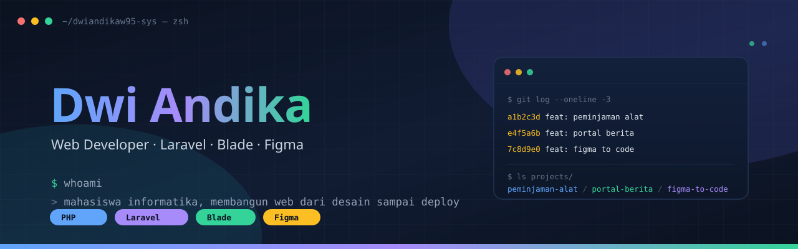

  

**Web Developer** · Laravel · Blade · PHP · Figma

---

## 👋 Tentang saya · About me

**ID** - Saya membangun aplikasi web dari nol: mulai dari desain di Figma, implementasi Laravel + Blade, sampai database MySQL. Saya suka antarmuka yang bersih, kode yang rapi, dan proyek yang benar-benar dipakai.

**EN** - I build web apps end to end: Figma design, Laravel + Blade implementation, MySQL data layer. I care about clean interfaces, readable code, and projects that actually get used.

- 🔭 Sedang mengerjakan · *Building:* aplikasi peminjaman alat & portal berita berbasis Laravel
- 🌱 Sedang belajar · *Learning:* REST API, testing, deployment
- 🤝 Terbuka untuk · *Open to:* kolaborasi proyek kampus, freelance web

---

## 🧰 Tech stack

---

## 🚀 Proyek unggulan · Featured projects

| Proyek | Deskripsi | Stack |
| :-- | :-- | :-- |
| **[aplikasi-peminjaman-alat](https://github.com/dwiandikaw95-sys/aplikasi-peminjaman-alat)** | Aplikasi peminjaman alat: data alat, peminjaman, pengembalian, dan status stok. | `Laravel` `PHP` `MySQL` |
| **[Tugas-portal-berita](https://github.com/dwiandikaw95-sys/Tugas-portal-berita)** | Portal berita dengan halaman kategori, daftar artikel, dan detail berita. | `Laravel` `Blade` |
| **[desain-figma-code-website](https://github.com/dwiandikaw95-sys/desain-figma-code-website)** | Konversi desain Figma menjadi website responsif. | `Blade` `HTML` `CSS` |
| **[dwi_middleware](https://github.com/dwiandikaw95-sys/dwi_middleware)** | Implementasi middleware Laravel untuk kontrol akses route. | `Laravel` `Blade` |
| **[mockup](https://github.com/dwiandikaw95-sys/mockup)** | Kumpulan mockup UI yang dipakai sebagai acuan implementasi. | `Blade` `Figma` |

Lihat semua repositori → [github.com/dwiandikaw95-sys?tab=repositories](https://github.com/dwiandikaw95-sys?tab=repositories)

---

## 📊 Statistik GitHub · GitHub stats

---

**Mari terhubung · Let's connect**

Terima kasih sudah mampir · Thanks for stopping by

