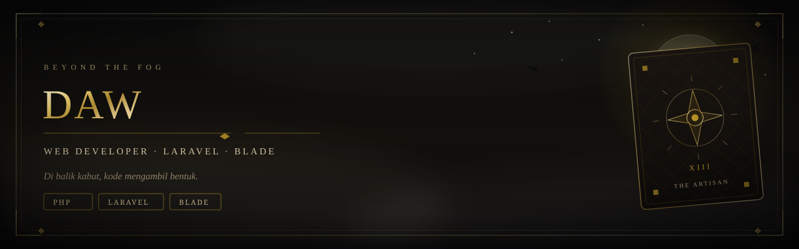



  

&#10022;&nbsp;&nbsp;<em>Di balik kabut, kode mengambil bentuk.</em>&nbsp;&nbsp;&#10022;

---

## &#8544;. Tentang Penulis &middot; About the Author

**ID** &mdash; Saya membangun aplikasi web dari nol: mulai dari desain di Figma, implementasi Laravel + Blade, sampai database MySQL. Saya suka antarmuka yang bersih, kode yang rapi, dan proyek yang benar-benar dipakai.

**EN** &mdash; I build web apps end to end: Figma design, Laravel + Blade implementation, MySQL data layer. I care about clean interfaces, readable code, and projects that actually get used.

- &#128302; **Sedang dikerjakan &middot; In progress:** aplikasi peminjaman alat &amp; portal berita berbasis Laravel
- &#127793; **Sedang dipelajari &middot; Learning:** REST API, testing, deployment
- &#129309; **Terbuka untuk &middot; Open to:** kolaborasi proyek, freelance web

---

## &#8545;. Teknik &middot; Techniques

---

## &#8546;. Catatan &middot; Records

| Bab &middot; Chapter | Ringkasan &middot; Summary | Teknik |
| :-- | :-- | :-- |
| **[aplikasi-peminjaman-alat](https://github.com/dawthedev/aplikasi-peminjaman-alat)** | Data alat, transaksi pinjam, pengembalian, dan status stok. | `Laravel` `PHP` `MySQL` |
| **[Tugas-portal-berita](https://github.com/dawthedev/Tugas-portal-berita)** | Portal berita: kategori, daftar artikel, dan detail berita. | `Laravel` `Blade` |
| **[desain-figma-code-website](https://github.com/dawthedev/desain-figma-code-website)** | Konversi desain Figma menjadi website responsif. | `Blade` `HTML` `CSS` |
| **[middleware-laravel](https://github.com/dawthedev/middleware-laravel)** | Middleware Laravel untuk kontrol akses route. | `Laravel` `Blade` |
| **[mockup](https://github.com/dawthedev/mockup)** | Kumpulan mockup UI sebagai acuan implementasi. | `Blade` `Figma` |

Semua arsip &rarr; [github.com/dawthedev?tab=repositories](https://github.com/dawthedev?tab=repositories)

---

## &#8547;. Perbintangan &middot; Observatory

---

&#10022;

**Mari terhubung &middot; Let's connect**

Terima kasih sudah mampir &middot; Thanks for stopping by

