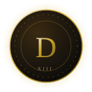



  

 

&#10022;&nbsp;&nbsp;<em>Di balik kabut, kode mengambil bentuk.</em>&nbsp;&nbsp;&#10022;

  

 

> *Kabut tidak menyembunyikan jalan &mdash; ia hanya menunda cahaya. Yang tekun membaca jejak akan sampai juga.*

---

## &#8544;. Tentang Penulis &nbsp;&#183;&nbsp; About the Author

**ID** &mdash; Saya membangun aplikasi web dari nol: rancangan antarmuka, implementasi Laravel + Blade, sampai basis data MySQL. Saya menyukai antarmuka yang bersih, kode yang mudah dibaca, dan proyek yang benar-benar dipakai orang.

**EN** &mdash; I build web apps end to end: interface design, Laravel + Blade implementation, MySQL data layer. I care about clean interfaces, readable code, and projects that actually get used.

<table>
<tr><td width="50%" valign="top">

**&#128302; Sedang dikerjakan**
Aplikasi peminjaman alat &amp; portal berita berbasis Laravel.

</td><td width="50%" valign="top">

**&#127793; Sedang dipelajari**
REST API, pengujian otomatis, dan deployment.

</td></tr>
<tr><td valign="top">

**&#129309; Terbuka untuk**
Kolaborasi proyek dan pekerjaan web freelance.

</td><td valign="top">

**&#9878; Prinsip**
Sederhana dulu, benar kemudian, cepat sebagai akibat.

</td></tr>
</table>

---

## &#8545;. Teknik &nbsp;&#183;&nbsp; Techniques

 

| Lapis &middot; Layer | Perangkat &middot; Tools |
| :-- | :-- |
| Antarmuka &middot; Interface | `Blade` `HTML` `CSS` `JavaScript` |
| Nalar &middot; Logic | `PHP` `Laravel` |
| Arsip &middot; Data | `MySQL` |
| Ritual &middot; Workflow | `Git` `GitHub` `VS Code` |

---

## &#8546;. Catatan &nbsp;&#183;&nbsp; Records

| Bab &middot; Chapter | Ringkasan &middot; Summary | Teknik |
| :-- | :-- | :-- |
| **[aplikasi-peminjaman-alat](https://github.com/dawthedev/aplikasi-peminjaman-alat)** | Data alat, transaksi pinjam, pengembalian, dan status stok. | `Laravel` `PHP` `MySQL` |
| **[Tugas-portal-berita](https://github.com/dawthedev/Tugas-portal-berita)** | Portal berita: kategori, daftar artikel, dan detail berita. | `Laravel` `Blade` |
| **[desain-ke-website](https://github.com/dawthedev/desain-ke-website)** | Konversi rancangan desain menjadi website responsif. | `Blade` `HTML` `CSS` |
| **[middleware-laravel](https://github.com/dawthedev/middleware-laravel)** | Middleware Laravel untuk kontrol akses route. | `Laravel` `Blade` |
| **[mockup](https://github.com/dawthedev/mockup)** | Kumpulan mockup UI sebagai acuan implementasi. | `Blade` `HTML` |

Seluruh arsip &rarr; [github.com/dawthedev?tab=repositories](https://github.com/dawthedev?tab=repositories)

---

## &#8547;. Perbintangan &nbsp;&#183;&nbsp; Observatory

---

### &#10022; &nbsp; Mari terhubung &nbsp;&#183;&nbsp; Let's connect &nbsp; &#10022;

&#10022; &nbsp; Terima kasih sudah mampir &nbsp;&#183;&nbsp; Thanks for stopping by &nbsp; &#10022;

